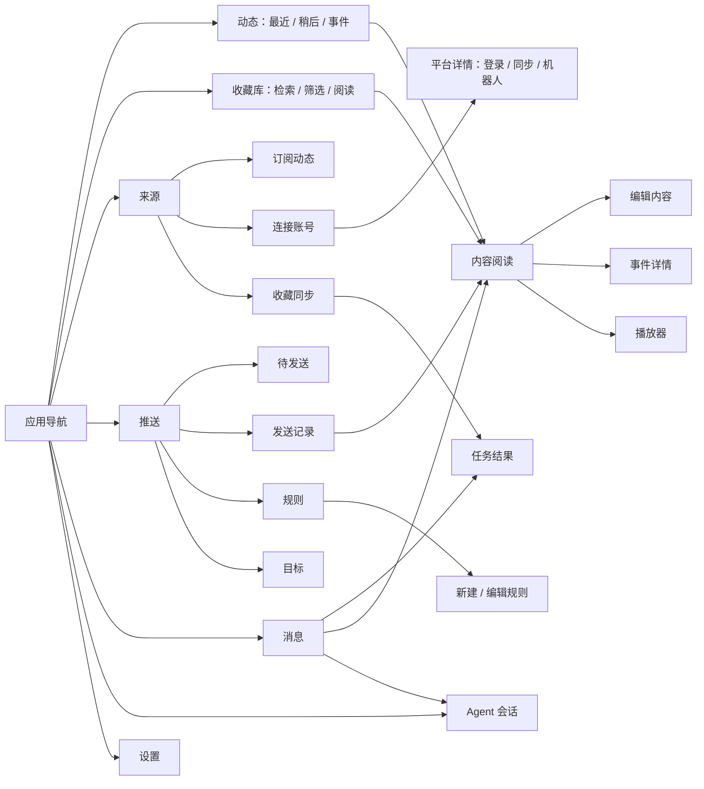

# VaultStream 页面、交互与性能审视

日期：2026-10-25。对象：当前 Flutter Web、真实收藏库及阿里云 FastAPI。本文把现有结构、已完成调整和产品取舍分开，便于后续决策。

## 1. 页面与任务地图

当前有七个工作区。动态处理新输入，收藏库阅读已保存内容，来源管理输入渠道，推送管理输出，消息查看结果，Agent 执行对话任务，设置管理全局偏好。全局搜索入口已删除，搜索留在收藏库中。

**导航层级的判断**：保留这七个工作区，暂不再增加一级入口。账号、同步和订阅都属于输入管理，但对象不同，使用同工作区内的三个标签合理。待发送、记录、规则、目标属于同一发送流程，也应留在一个工作区。任务结果与事件详情是对象页，播放器是持续会话，均不需要独立的一级导航。

路由的真实落点：

| 入口 | 地址与状态 | 下一级 / 返回关系 |
|---|---|---|
| 动态 | `/home`，`?item=ID` | 宽屏原位打开阅读；窄屏内容详情；返回列表保留位置 |
| 收藏库 | `/collection`，筛选 query，`?item=ID` | 同一列表/阅读容器；`/collection/:id` 支持独立深链 |
| 内容编辑 | `/collection/:id/edit` | 返回当前内容；有改动的草稿才需要退出提示 |
| 订阅动态 | `/sources` | 添加/编辑来源在原工作区展开；宽屏保留左侧列表，窄屏显示编辑区 |
| 连接账号 | `/accounts` | `/accounts/:platform`，Telegram、QQ 及内容平台按能力呈现 |
| 收藏同步 | `/sources/sync` | 单平台控制在账号详情；运行结果进入任务页 |
| 推送 | `/automation/distribution` | `history`、`rules`、`targets` 为同层标签 |
| 规则编辑 | `rules/new`、`rules/:ruleId` | 宽屏列表收折后编辑；窄屏单栏；返回保留列表上下文 |
| 消息 | `/notifications` | 宽屏原位看任务/内容，窄屏返回列表；账号/Agent 消息进入相应领域 |
| Agent | `/agent?session_id=…` | 会话、草稿、运行状态属于同一工作台 |
| 设置 | `/settings?tab=…` | 桌面分区导航，手机先选分区；七个分区见下表 |
| 任务 / 事件 | `/tasks/:runId`、`/events/:id` | 稳定深链接，返回来源页面 |
| 播放器 | `/player` 与应用级展开层 | 复用播放会话；收起不新建播放器 |
| 连接与许可 | `/connect`；应用内许可页 | 连接页负责进入应用；许可是外观设置下的次级阅读 |

## 2. 逐界面判断与调整

### 核心工作区

| 界面 | 内容组织与布局判断 | 横竖屏、状态与动效 |
|---|---|---|
| 动态：最近 / 稍后 | 保留时间流。收录、稍后和低频菜单围绕单条内容，不把评分、来源诊断全部外显。事件是独立内容类型而非混入普通卡片。 | 宽屏卡片收折到侧栏后阅读；窄屏整页阅读。新增同步结果现在能更新列表，保留已加载的页数。 |
| 收藏库 | 搜索、处理状态、平台、标签、日期属于检索任务。状态使用分段选择；较多平台/标签使用带勾选的菜单，避免整页外显 chips。 | 共享卡片/列表转换与阅读容器。菜单使用同一表面语义，选中不改变条目尺寸。首次 SSE 连接不再引起重复拉取。 |
| 文章阅读 | 正文是主内容，作者、时间、目录是辅助信息；不为元信息另包大卡片。 | 列表与阅读并排时不再为标签和目录自动增加第三栏；目录使用阅读浮条，独立/专注阅读才按目录数量展开侧栏。正文重组件延后到分栏过渡结束后挂载，保留滚动与选择。 |
| 图文阅读 | 图片与文字分别承担观看和阅读任务；缩略图应按实际数量收缩，图片裁切与外框共用边界。 | 当前共用媒体查看器与紧凑缩略图条；失败状态只占媒体区域，允许重试。媒体远端不可用与布局问题分开判断。 |
| 音视频 / 播放器 | 底部条只保留内容、播放和关闭；完整控制在展开层。持续会话不跟随页面销毁。 | 复用同一控制器、播放进度和展开/收起转场，避免打开详情重新初始化播放。 |
| 文档阅读 | 页码、PDF 与提取正文属于一个阅读任务，维持文档专用布局。 | 当前库中无文档样本；本轮核对代码、导航与空态，不把不存在的真实样本写成已验证的阅读性能。 |
| 内容编辑 / 捕获 | 简单捕获继续使用临时表单，正文编辑保留独立页面。不要给每种输入建立一个工作区。 | 表单按可用高度滚动；编辑返回保留内容来源；错误必须留住输入。 |
| 发送记录 | 记录需要可回看内容，不能把整张屏幕用于一列左贴边文字。 | 当前复用列表/阅读收折容器；宽屏右侧阅读，窄屏单页，关闭阅读回到同一记录位置。 |
| 待发送 | 展示待处理对象及发送状态，规则筛选属于工具栏。 | 空队列显示真实空态，不造统计装饰；实时刷新保留当前规则筛选。删除了无人消费的队列统计 provider 和无效刷新链。 |
| 规则列表 / 编辑 | 列表管理规则，编辑页组织条件、时间和目标。目标仍是可复用对象，编辑内用选择/管理弹层，不跳出草稿。 | 沿用共享列表收折及内容切换。后端已有规则与目标的原子提交，不另造第二套保存机制。 |
| 目标 | 群组名称、平台、可用性、启用开关是一条完整记录，使用一体分组表面。 | 列表限宽、居中；手机不撑成巨大卡片。进入目标管理不再加载无关系统设置和机器人总状态。 |
| 消息列表 / 详情 | 消息解释发生了什么，任务页解释结果与失败原因。技术诊断默认折叠。 | 已关闭的筛选实例和任务详情不再永久保留 SSE 订阅；宽屏原位详情，窄屏返回恢复列表。 |
| Agent | 保留会话、回答、引用、输入四个层次。工具详情按需展开，不把参数、token 用量作为每条消息主体。 | 窄屏输入区、会话选择与更多菜单可达；宽屏最多会话与对话两栏，引用留在对应回答。历史读取与待确认状态并行加载，各有用途。 |
| 事件详情 | 成员时间线、角色与证据状态属于内容关系，不能拿普通标签代替。 | 当前库中事件为空。本轮核对入口、空态、编辑结构与后端关系，不添加伪造事件充当验证。 |
| 任务结果 | 业务结果、相关内容、下一步入口在前，诊断在后。 | 可从消息内嵌或深链打开；详情离开后释放实时订阅。不同任务的重试继续由业务接口处理。 |

### 来源和设置

| 界面 | 结论 / 本轮处理 | 后端能力 |
|---|---|---|
| 订阅动态 | 从 AI 设置组件中拆出 `SubscriptionsView`，移除跨域依赖。机器人群组折叠区首次展开才加载。来源编辑使用标准有标签输入框，与账号详情一起接入列表收折工作区；两个短筛选按内容宽度并排，避免手机上无必要地占两行。 | 来源 CRUD、手动同步、同步间隔、订阅源任务与运行结果 |
| 连接账号 | 消息账号、内容平台分组；机器人转存收藏开关移入消息账号组，删除通知页的重复账号入口。 | 平台健康、登录状态、Cookie、保活、机器人转存策略 |
| Telegram | 个人账号、频道同步、机器人为不同能力，按分组展示；不强行变成内容平台的 Cookie 表单。 | MTProto 连接与订阅同步、Bot 配置/进程控制、群组 |
| QQ | 保留机器人与群组管理，复用现有账号结构。 | NapCat 连接、Bot 权限和群组目标 |
| 知乎 / 小红书 / X / 微博 / Bilibili | 同一平台详情骨架，按平台实际能力显示登录、检测、退出、收藏同步；没有能力的动作不补空位。 | 浏览器登录、凭据管理、平台检查、对应收藏 fetcher |
| 收藏同步 | 全平台状态/操作/记录在本页，单平台设置仍在账号详情。避免复制两个控制面。 | 同步状态、预览、执行、策略、失败项重试与账本 |
| 设置：外观与系统 | 外观选择与许可足够，不增加无用途的仪表盘。 | 本地偏好与应用信息 |
| 设置：通知 | 只保留摘要开关、周期和生成；移出机器人接入管理。周期关闭时仍可配置，手动生成语义独立。 | 设置读写、通知摘要 |
| 设置：内容处理 | 解析、媒体归档、摘要、整理、索引按处理流程分组。诊断属于可进入的详情。 | 队列开关、后处理策略、诊断、索引状态 |
| 设置：AI 模型 | 模型配置与能力诊断分开，后者首次展开才读取。不将“已配置”误写成“连通成功”。 | 普通/摘要/向量模型设置、模型发现、连通性、语义索引 |
| 设置：筛选与保留 | 兴趣、阈值、保留期和清理策略属于同一筛选流程，保持紧凑表单。 | discovery settings、巡逻评分与保留策略 |
| 设置：媒体与存储 | 归档策略与下载参数属于全局设置，不复制到每条内容详情。 | storage 配置、媒体归档/修复 |
| 设置：连接与访问 | 只负责 VaultStream 服务连接、密钥、网络代理和退出；不再承担平台账号管理。 | 连接/健康检查、配置 API；本地连接信息 |

### 组件取舍

继续以 `material_ui` / Material 组件、`material_3_expressive` 和共享主题为基础。保留的自制部分有明确业务职责：列表/详情工作区、整合式选择菜单、媒体播放会话、内容模板、任务结果 renderer。它们不应演变成另一套按钮、输入、开关和基础导航库。

分组列表采用外部较大、内部较小的圆角，菜单和展开区共用一个表面；不是把每一行都变成独立胶囊。可读内容限宽，宽屏的空白承担阅读边界，不以拉高条目、放大按钮或新增说明卡填满。

本轮删除或减去：无消费者的 Dashboard/系统健康 provider、分发统计 provider 及刷新链；通知页重复账号入口；来源页对 AI 设置的复用分支；初始 SSE 刷新；收起内容的首次预加载；设置单字段保存后的全量 GET。保留了已有鉴权、发送结果防重和真实业务约束，没有新增门禁、审计层或缓存框架。

## 3. 实测与性能处理

测试使用本机 Chrome 与真实 API。下面是单次操作样本，不是 P95；网络时延和服务器负载会影响毫秒数。请求数量与生命周期是本轮确定性的改进目标。

| 场景 | 调整前实测 | 调整后 |
|---|---|---|
| 应用启动通知 | 同一 `notifications` 请求 2 次，约 151/155 ms | 1 次，94 ms |
| 恢复暂停内容 | 同一 `contents/:id` 请求 2 次，约 151/121 ms | 1 次，72 ms；原暂停状态保留 |
| 订阅动态首次进入 | settings、sources、bot/status、bot/chats 共 4 次 | 仅 sources 1 次，99 ms |
| AI 能力折叠区 | 未展开已读取 capabilities | 收起时 0 次；首次展开 1 次，178 ms |
| 单字段设置保存 | PUT 后使全量 settings 失效，再 GET | 修改摘要周期仅 1 次 PUT，79 ms；恢复原值仍仅 1 次 PUT，36 ms |
| DNS 校验 | 12 个真实封面域名，事件循环最大间隔 2072 ms | 改为异步 DNS，同组域名复测最大间隔 19 ms |
| 小红书旧图片地址 | 样本 `26772` 上游 403，等待后仍失败 | 重新读取原笔记、按原图片 ID 取得新地址；两张图完整下载及解码成功，分别约 1067 / 429 ms |
| WebP 代理缓存 | 线上容器 `mimetypes.guess_type('cache.webp')` 返回空，已有缓存无法识别 | 按实际写入格式映射 MIME；Chrome 已收到 `200` / `X-Cache-Status: HIT` |
| 收藏列表内部耗时 | 查询 141/46 ms，20 条摘要生成均约 196 ms，媒体清单 37/29 ms | 确认没有把约 11 秒封面等待误归因于卡片形变 |
| Agent 首次进入 | 会话列表 226 ms；消息与待确认并行约 203/204 ms | 三个请求用途不同，保留并行读取 |
| 来源健康 / 同步状态 | 633 / 419 ms | 保留现有状态语义，不添加一层会隐藏登录过期的长期缓存 |

图片检查发现同步 `socket.getaddrinfo` 出现在异步下载和浏览器请求拦截里。实际域名查询曾耗时 2062 ms，事件循环同时停顿。这会让其他 API 和图片一起等待。已将共用校验、直连 DNS 与所有调用点改为异步，保持目标限制与连接到已核验地址的行为。

该实现使用 Python 标准异步 DNS，不增加依赖。官方说明 `loop.getaddrinfo` 在线程执行同步解析，让事件循环继续调度：[Python asyncio DNS](https://docs.python.org/3.12/library/asyncio-eventloop.html#dns)。前后两次 DNS 耗时受缓存影响，不能把 2072→19 ms 描述成 DNS 本身提速百倍；这是调度阻塞的改善。

卡片到列表的流畅度来自现有工作区的连续约束变化、网格测量缓存、可见内容按需构建，以及在过渡结束后挂载重阅读内容。没有证据表明需要重写这套转场。本轮保留它，也不把静态构建通过或主观流畅写成 60/120 FPS 数据。

## 4. 前后端职责与取舍

| 前端任务 | 主要 API / 后端职责 | 判断 |
|---|---|---|
| 收藏检索与阅读 | `/search/unified`、`/contents`；搜索 service、内容 repository、媒体 manifest | 筛选排序在后端；前端不再因任务进度事件重读整份收藏列表，内容变化仍通过 content 事件更新 |
| 动态输入 | `/discovery/items`、`/discovery/sources`；同步任务、来源关联、评分/保留 | 修复同步成功后首页不更新的缺口；复用已有任务事件，不添加轮询或新接口 |
| 账号 / 收藏同步 | `/platform-health`、`/favorites-sync/*`、平台认证 | 平台登录与收藏授权不是完全相同的能力，不能把两个检查机械删成一个。现阶段数据量小，不拆微服务 |
| 规则 / 队列 / 目标 | `/distribution-rules`、`/distribution-queue/items`、`/bot/chats` | 对象复用和规则原子保存已有实际价值；移除无人使用的前端统计，不为统一名字重写后端业务 |
| 消息 / 任务 | `/notifications`、`/background-tasks/*`、`/events/subscribe` | SSE 提醒重读，不作为事实数据；初次连接和恢复连接区分，关闭的详情释放监听 |
| Agent | `/agent/sessions`、消息、确认、运行流 | 会话历史、运行状态和工具结果由后端持久化。现有并行读合理，不添加页面端镜像数据库 |
| 设置 | `/settings`、`PUT /settings/{key}` | PUT 已返回规范化后的真实设置，直接合并此响应；删除设置仍重新读取，因为可能恢复环境默认值 |
| 媒体 | manifest、blob、`/proxy/image` | DNS 使用异步；图像解码已有线程处理；保留同 URL 下载去重，避免多张卡片重复下载 |
| 人工事件 | `/knowledge-events` | 关系、分类、证据状态有独立领域含义，保留 API；当前库空，不为了填界面自动造事件 |

收藏查询本次读取了约 16 KB 卡片未使用的 JSON。相对当前几十毫秒的查询，不值得立即新增第二套投影参数与缓存层。摘要生成约 196 ms 是已量出的 CPU 成本；当前是每页 20 条，尚无必要为此建立持久摘要缓存/新 worker。若以后改为更大的批量输出，应在现有内容展示服务统一处理，而不是前端猜正文、截 HTML。

错误反馈修正为优先使用后端已返回的业务消息。固定产品术语仍统一翻译；未列入少数枚举的错误不再一律被覆盖成“保存失败”。这利用现有错误 contract，没有新增字符串猜测分支。

## 5. 决策清单

| 决策 | 结果 / 建议 |
|---|---|
| 本轮直接实施 | 异步 DNS、小红书过期图片地址恢复、WebP 缓存识别、SSE 初连/重连区分、通知/任务订阅释放、折叠区延迟加载、设置响应原位更新、动态同步后刷新、删除死 provider、来源组件拆分、通知与机器人职责重排、业务错误就地显示 |
| 保留 | 七个工作区、共享列表/阅读转场、应用级播放会话、文章/图文/媒体/文档的不同模板、后端规则原子保存、任务结果深链 |
| 不做 | 新增全局搜索入口、为所有选项建立页面、统一成一种巨型表单、强行铺满宽屏、额外客户端数据缓存框架、为了统计而保留无人消费的请求链 |
| 后续产品选择 | 如果事件组织成为高频任务，再决定是否给予更直接入口；现在维持动态/内容内的关系入口即可。没有必要先为零数据场景建设独立工作区 |

已部署到 [VaultStream](https://vaultstream.ienone.top/)，Web 使用 `product-review-20261025`，API 使用 `product-review-media-20261025`。`flutter analyze` 无问题，Web release/Wasm 构建与修改后端模块编译通过。

最终 API 健康检查通过。利用本次真实服务重启验证了自动重连：恢复后通知、当前收藏查询、阅读内容与暂停播放内容各重读一次，已关闭的账号类别没有再次请求。没有使用伪造事件或响应。

实际操作覆盖宽屏 1440×1000、中等宽度 900×1000、手机竖屏 390×844 和短横屏 844×390。核对了收藏卡片展开、宽窄切换后保持当前内容、发送记录原位阅读与返回、新建规则及取消、订阅来源添加表单、账号分组、AI 诊断按需展开、通知周期修改与恢复、消息类别空态及返回。规则没有保存测试数据，摘要周期已恢复“每天”，没有开启外部发送。

真实库提供了文章、图文和视频样本；文档和人工事件数量均为 0。这两类页面核对的是代码、导航、接口与空态，其阅读性能没有真实样本结论。

图文样本 `26772` 的两张图片因旧签名地址失效被上游返回 403。原笔记仍可读取，刷新地址后得到 1080×1527 和 1000×4664 的完整 WebP 图片。恢复流程复用既有解析器和代理缓存，只匹配同一平台图片 ID，每次下载最多刷新一次，不覆盖正文或触发推送。文章样本 `28393` 的正文图片正常显示，发送记录样本 `27094` 能在原工作区打开完整正文。

发布后的 Chrome 已实际显示该笔记两张图片与缩略图，切换、打开图集、放大及关闭正常；图片代理响应为 200，后续请求命中缓存。列表保留图集全貌，长图细节通过既有查看器缩放阅读。

主要实现入口：

- [SSE 连接与刷新](../../../frontend/lib/core/network/sse_service.dart)
- [来源订阅页面](../../../frontend/lib/features/sources/subscriptions_view.dart)
- [设置原位更新](../../../frontend/lib/features/settings/providers/settings_provider.dart)
- [折叠区生命周期](../../../frontend/lib/features/settings/presentation/widgets/setting_components.dart)
- [通知查询生命周期](../../../frontend/lib/features/notifications/notification_provider.dart)
- [异步 DNS 与下载连接](../../../backend/app/core/safe_fetch.py)
- [小红书图片地址恢复](../../../backend/app/services/xiaohongshu_media_refresh.py)
